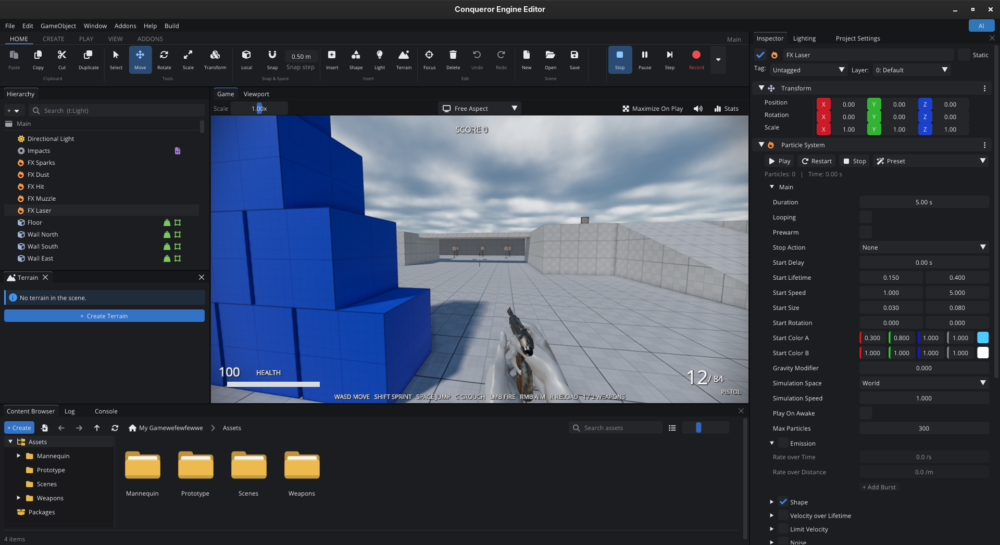
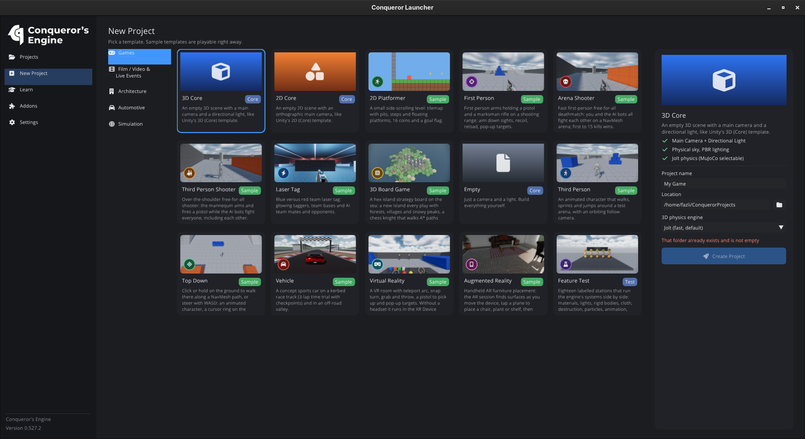
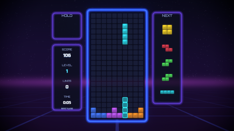
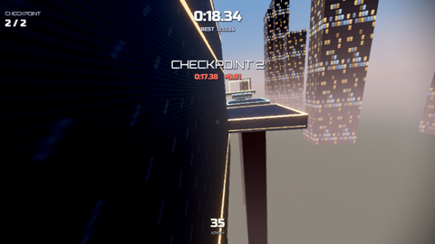
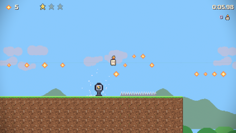

# Conqueror's Engine (Libre Engine)

A 2D/3D game engine and editor written in C++23, with OpenGL, Vulkan, Direct3D 11, Direct3D 12 and Metal backends,
nine scripting languages plus visual scripting, and a Unity/Roblox-style editor.

**Version:** 0.547.2

## Documentation

Guides and generated reference pages are in [Docs/](Docs/README.md): [getting started](Docs/GettingStarted.md),
[editor](Docs/Editor.md), [scripting](Docs/Scripting.md), [rendering](Docs/Rendering.md), [platforms](Docs/Platforms.md),
[testing](Docs/Testing.md), and the full [component](Docs/Reference/Components.md), [scripting API](Docs/Reference/ScriptingAPI.md),
[console variable](Docs/Reference/ConsoleVariables.md) and [automation](Docs/Reference/Automation.md) references.

## Images




## Features

**Rendering**
- HDR PBR forward renderer with cascaded shadow atlas, image-based lighting (prefiltered environment + L2 irradiance),
  reflection probes, adaptive probe volumes, lightmaps, fog, SSAO, bloom, tonemapping
- Anti-aliasing: FXAA, SMAA (and SMAA T2X), TAA, MSAA, SSAA, CMAA2, MLAA and more (some need vendor OpenGL extensions);
  upscaling: FSR 1, FSR 2.2, NVIDIA Image Scaling, TAAU, Snapdragon GSR 1, Lanczos, Bilinear and Nearest-Neighbor, plus CAS sharpening
- DLSS, XeSS, MetalFX and PSSR appear in the editor but are **not integrated** (their SDKs need Vulkan/DirectX, Windows,
  Apple or console toolchains); the editor shows the reason next to each one
- Batched 2D renderer, sprite sheets and sprite editor, tilemaps (square/hex), text (FreeType), particles, ribbons/trails, terrain
- Shader pipeline: GLSL -> SPIR-V (glslang) -> GLSL / HLSL / MSL (SPIRV-Cross) with a disk cache, plus a Shader Graph editor
- Graphics backends: OpenGL 4.6, Vulkan 1.2/1.3, Direct3D 11, Direct3D 12, Metal (see [Graphics backends](#graphics-backends))

**Editor**
- Docking editor with a ribbon toolbar, Hierarchy (icons, search), Inspector (Add Component, undo/redo), Content Browser,
  Viewport (picking, gizmos, shading/debug views, view cube, stats), Game view (resolution selector), Log + Console terminal,
  Lighting, Project Settings, Build Settings, Profiler, Timeline, Animator, Audio Mixer, Terrain, Tile Palette, Sprite Editor,
  Shader Graph, Visual Scripting, Code Editor (completion and diagnostics for every language), Multiplayer, Addons, AI assistant
- Prefabs (apply/revert/unpack), undo/redo, play mode, screen recorder, project hub (launcher) with templates

**Scripting** — every language talks to the engine through the same `nativebridge` function table (930+ functions):

| Language | Runtime |
|----------|---------|
| ConquerorScript (`.cqs`) | own compiler + VM with an sljit JIT |
| LuaQ (`.luaq`) | our own Lua dialect: superset of Lua 5.4 and Luau (bitwise ops, goto, `<close>`, types, `continue`) plus classes, enums, `match`, `?.`/`??`, arrow functions, default parameters, `defer`, destructuring, spread and `async`/`await`; compiled to Luau with line numbers preserved and run on the embedded Luau VM |
| C# (`.cs`) | .NET via hostfxr (if a .NET SDK is installed) |
| Python (`.py`) | embedded CPython (if the development files are found) |
| Java (`.java`) | JNI (if a JDK is found) |
| C++ (`.cpp`) | compiled to a shared library with the system compiler, C ABI boundary |
| C (`.c`) | real C23 (not C++), same automatic shared-library build and C ABI |
| Rust (`.rs`) | compiled with `rustc` into a cdylib (no cargo needed); `script!` macro for Inspector fields |
| Zig (`.zig`) | compiled with `zig build-lib` (Zig 0.14–0.17); fields and methods found by comptime reflection |
| Visual scripts (`.cqgraph`) | node graphs transpiled to ConquerorScript |

**Simulation and systems**
- 3D physics: Jolt (default) or MuJoCo (optional runtime) behind one backend interface; character controller, joints, triggers
- 2D physics: Box2D 3 with joints and effectors
- ECS (EnTT), scene serialization (YAML), scene management, timeline (tracks, signals, audio), skeletal animation + animator,
  audio (miniaudio) with a mixer, UI canvas system (buttons, sliders, layout, masks), grid/hex system with A* pathfinding
- Multiplayer (ENet host/server/client, replication, RPCs, network variables), optional Steam (lobbies, P2P) loaded at runtime
- Build pipeline producing a standalone game folder, player settings (window, fullscreen, icon, graphics API)

**Game API and robustness**
- Script access to UI (text, colors, visibility, sliders, clicks, events), particles (play/emit at a point), cameras,
  render settings (fog, shadows, post-processing), the character controller (ground entity, flags), physics queries,
  script-to-script messaging (`SendMessage`, `GetScriptField`/`SetScriptField`, globals) and one-shot / 3D audio (WAV, MP3, OGG, FLAC)
- PlayerPrefs (`PrefsSetInt/Float/String`) and save files in the per-user data folder
- Safe entity destruction from scripts (`OnDestroy`, Unity-order `Awake`/`Start`), gamepad support with the standard layout
- Crash handler (stack trace report + minidump on Windows), editor recovery snapshots and unsaved-changes prompts

## Graphics backends

All engine rendering code targets the OpenGL 4.5 API. The Vulkan, Direct3D 11, Direct3D 12 and Metal backends are **translation layers**
(the ANGLE/Zink approach): the ~124 GL entry points the engine and ImGui use are routed through glad into a shared GL
front-end (`Engine/src/Renderer/GraphicsAPIs/GLEmu`), which records into Vulkan (`.../Vulkan`) or Direct3D 11 / 12 (`.../DirectX/D3D11`, `.../DirectX/D3D12`).
Shaders are compiled GLSL -> SPIR-V; Vulkan consumes the SPIR-V directly, Direct3D 11 and 12 receive HLSL generated by
SPIRV-Cross and compiled with `d3dcompiler_47` (shared code in `.../DirectX/Common`).

| Backend | Selected by | Notes |
|---------|-------------|-------|
| OpenGL 4.6 | default on Linux, `--opengl` | reference backend |
| OpenGL 4.5 / 4.1 / 3.3 core, OpenGL ES 3.2 / 3.1 / 3.0 | `--gl=4.1`, `--gl=es3.0`, `CQ_GL_PROFILE`; ES is the default on Android, QNX and AGL builds | missing GL 4.5 functions are emulated, shaders are cross-compiled to the target GLSL / GLSL ES version ([details](Docs/Automotive.md#opengl-profiles)) |
| Vulkan 1.3 (or 1.2 + `VK_KHR_dynamic_rendering` / `VK_EXT_extended_dynamic_state`) | `--vulkan` | loader opened at runtime (no SDK needed to build, no hard dependency on `vulkan-1.dll` / `libvulkan`); MoltenVK portability supported |
| Direct3D 11 (feature level 11_0) | `--d3d11`, default on Windows | own mip generation, depth resolve via shader, large sampler arrays split for the 16-sampler limit |
| Direct3D 12 (feature level 11_0, Windows 10+) | `--d3d12` | `d3d12.dll` opened at runtime; one root signature (12 root CBVs + SRV/sampler tables), pipeline state cache, per-resource state tracking, 3 frames in flight; falls back to Direct3D 11 if unavailable |
| Metal (macOS 10.15+) | `--metal`, default on macOS | shaders SPIR-V -> MSL (SPIRV-Cross) compiled at runtime; constant buffers at buffer index 16+; falls back to Vulkan/MoltenVK. **Written on Linux and not yet compiled on a Mac** (checked in the macOS CI build) |

Selection priority: command line (`--opengl`, `--vulkan`, `--d3d11`, `--d3d12`, `--metal`, `--renderer <name>`) > `CQ_RENDERER` environment
variable > Project Settings > Player > Rendering > Graphics API ("Auto" = platform default). If the chosen backend cannot be
initialised, the window falls back to OpenGL (Direct3D 12 first tries Direct3D 11, Metal first tries Vulkan). When a Windows build runs under Wine/Proton, "Auto" picks Vulkan.

Debugging: `CQ_VK_VALIDATION=1` enables the Vulkan validation layer, `CQ_VK_DEVICE=<name>` picks a GPU,
`CQ_VKGL_DUMP=<dir>` / `CQ_DXGL_DUMP=<dir>` / `CQ_MTLGL_DUMP=<dir>` write the translated shaders, `CQ_D3D_DEBUG=1` enables the D3D11 debug device / D3D12 debug layer.

## Platform status

| Platform | Status |
|----------|--------|
| Linux (x86-64) | primary platform; full automated test suite passes on OpenGL and on Vulkan (with validation layers) |
| Windows (x64) | builds with MSVC or MinGW (clang/gcc); the cross-compiled build was tested under Wine on OpenGL, Vulkan, Direct3D 11 and Direct3D 12 |
| macOS | platform code paths, the Metal backend and the Vulkan/MoltenVK backend exist, but this build has **not** been compiled or tested on a Mac |
| Android 8.0+ (arm64-v8a, x86_64) | player only (NativeActivity, OpenGL ES 3); APKs built from the editor or `Tools/Android/package_apk.py`; tested on the Android 15 emulator |
| Android Automotive OS | same APK with the automotive feature; tested on the Android 14 Automotive emulator |
| Automotive Grade Linux / Yocto | Yocto layer in `Tools/AGL/meta-conqueror` (Wayland, OpenGL ES 3.2, player only); the configuration is tested on desktop Linux, not in a real AGL image |
| QNX 7.1 / 8.0 | Screen + EGL platform layer and toolchain file; **not compiled** (needs the QNX SDP) |
| FreeBSD 14 (x86-64) | engine + player cross-compiled and linked for FreeBSD 14.5 (clang, FreeBSD sysroot); not run on a FreeBSD machine yet. OpenBSD / NetBSD / DragonFly code paths exist but were not compiled |

See [Docs/Automotive.md](Docs/Automotive.md) for Android, Android Automotive, AGL and QNX.

## Sample games

Three complete games made only with the engine live in `Samples/` (open the `.cqproj` in the editor and press Play):

| | |
|---|---|
|  | **[Tetris](Samples/Tetris/README.md)** — modern-guideline falling blocks: SRS rotation with wall kicks, 7-bag, hold, ghost, lock delay, T-spins, back-to-back, combos, perfect clears, effects, menus and saved best score. |
|  | **[Parkour](Samples/Parkour/README.md)** — first-person time trial with 24 levels in six themed worlds and a level-select menu: sprint, double jump, wall-run, wall-jump, slide, ledge mantle, jump pads, moving platforms, checkpoints with splits, medals and saved records. |
|  | **[Ember Trail](Samples/EmberTrail/README.md)** — original 2D pixel-art platformer: six levels in three worlds, autotiled tilemaps, dash, stomp, springs, moving and crumbling platforms, 2D-lit caves, sun shards, medals and a level-select screen. |

All three are covered by the automated tests (every Parkour and Ember Trail level is completed end-to-end by a scripted autopilot; Ember Trail's solutions are found by a solver and replay tick-exact in the engine).

## Requirements

- CMake 3.20 or newer and a C++23 compiler (GCC 13+, Clang 17+, MSVC 2022)
- A GPU with OpenGL 4.6, Vulkan 1.2+, Direct3D 11 or Direct3D 12
- Linux: X11/Wayland development packages
- Optional: Python 3 development files, a JDK, a .NET SDK (enable those scripting languages); MuJoCo runtime for the MuJoCo physics backend

## Building from Source

### Linux

```bash
# Dependencies (Fedora)
sudo dnf install cmake gcc-c++ mesa-libGL-devel libXrandr-devel libXinerama-devel libXcursor-devel libXi-devel \
    wayland-devel libxkbcommon-devel

git clone https://github.com/conquerorsengine/conqueror.git
cd conqueror
cmake -B build -DCMAKE_BUILD_TYPE=Release
cmake --build build -j$(nproc)
```

### FreeBSD (and other BSDs)

```bash
pkg install cmake ninja pkgconf python3 xorgproto libX11 libXrandr libXinerama libXcursor libXi libXext \
    libxkbcommon wayland wayland-protocols evdev-proto gtk3
cmake -B build -G Ninja -DCMAKE_BUILD_TYPE=Release
cmake --build build
```

`gtk3` is only needed for the editor's file dialogs; `-DCQ_RUNTIME_ONLY=ON` builds just the engine and the player.
Cross-compiling from Linux: `Tools/BSD/freebsd-cross.toolchain.cmake` (clang + an extracted FreeBSD `base.txz`).

### Windows

```bash
git clone https://github.com/conquerorsengine/conqueror.git
cd conqueror
cmake -B build -DCMAKE_BUILD_TYPE=Release          # Visual Studio 2022 or Ninja + MSVC/MinGW
cmake --build build --config Release -j %NUMBER_OF_PROCESSORS%
```

The engine core and ImGui are linked statically on Windows; MinGW builds link the C++ runtime statically, so the game
folder only needs system DLLs (`d3d11`, `d3dcompiler_47`, ...).

### CMake options

| Option | Default | Meaning |
|--------|---------|---------|
| `CQ_ENABLE_VULKAN` | ON | build the Vulkan backend (headers are vendored in `External/Vulkan-Headers`) |
| `CQ_NATIVE_ARCH` | OFF | optimise for this CPU (`-march=native`); default builds target x86-64-v2 so games run on any x64 CPU |
| `CQ_ENABLE_ASAN` | OFF | AddressSanitizer + UBSan for engine/editor code |
| `CQ_LINUX_ENGINE_CORE_STATIC` | OFF | link the engine statically on Linux too |
| `CQ_IMGUI_SHARED` | OFF | build ImGui as a DLL (only needed for a DLL engine on Windows) |
| `CQ_RUNTIME_ONLY` | OFF | build only the engine and the player (embedded / automotive images; always on for Android and QNX) |
| `CQ_DEFAULT_GL_PROFILE` | empty | OpenGL profile used when none is requested, e.g. `es3.2` for embedded Linux |
| `CQ_ENABLE_JOLT` | ON | JoltPhysics 3D physics (off on QNX) |

## Running

```bash
cd build/bin
./ConquerorLauncher             # project hub: create/open projects from templates
./ConquerorEngine <project-dir>  # editor
./ConquerorRuntime <project-dir> # play a project without the editor (built games use this player)
```

Useful command-line options: `--opengl` / `--vulkan` / `--d3d11`, and for multiplayer games `--host`, `--server`,
`--connect <address>`, `--port <n>`.

## Project Structure

```
YourProject/
  Assets/
    Scenes/       - Scene files (.cqscene)
    Scripts/      - .cqs, .luaq, .cs, .py, .java, .cpp, .c, .rs, .zig, .cqgraph
    Prefabs/      - .cqprefab
    Timelines/    - .cqtimeline
    Textures/, Materials/, Models/, Audio/
  Packages/       - Addons installed from the Addon Manager
  Library/        - Editor cache (thumbnail, imports)
  ProjectName.cqproj - Project configuration (player, build, physics settings)
```

## Scripting examples

ConquerorScript:

```
using nativebridge;

script PlayerController : ConquerorScript
{
    [Header("Movement")]
    [Tooltip("Units per second")]
    [Range(1, 20)]
    public float moveSpeed = 5.0;

    func Start() { LogInfo("Player ready"); }

    func Update(dt)
    {
        // IsKeyPressed = held, IsKeyDown = pressed this frame, IsKeyUp = released this frame
        var move = 0.0;
        if (IsKeyPressed(Key.A)) { move = -1.0; }
        if (IsKeyPressed(Key.D)) { move = 1.0; }
        var v = GetLinearVelocity();
        SetLinearVelocity(move * moveSpeed, v.y, v.z);
        if (IsKeyDown(Key.Space)) { AudioPlayOneShot("Assets/Audio/jump.wav"); }
    }

    func OnCollisionEnter(other, name) { LogInfo("Hit " + name); }
}
```

LuaQ:

```lua
enum Mode { Idle, Spin }

class Spinner extends Mover
    speed = 90.0                        -- shown in the Inspector

    function Update(dt: number)
        local r = GetRotation()
        SetRotation(r.x, r.y + self.speed * dt, r.z)
        self.target?.Ping()                    -- optional chaining
        local name = self.label ?? "spinner"   -- nil coalescing
    end

    async function Blink()
        await 0.5                              -- coroutine task, resumed by the engine
        SetVisible(false)
    end
end                                     -- the class named like the file is returned automatically
```

C#:

```csharp
using Conqueror;
using static Conqueror.NativeBridge;

public class Orbiter : ScriptBehaviour
{
    [Range(0, 20)] public float speed = 2f;

    void Update(float dt)
    {
        var r = GetRotation();
        SetRotation(r.x, r.y + speed * dt, r.z);
    }
}
```

Python:

```python
from nativebridge import *

class Spinner:
    speed = 90.0          # shown in the Inspector
    _angle = 0.0          # names starting with _ stay hidden

    def update(self, dt):
        self._angle += self.speed * dt
        SetRotation(0, self._angle, 0)
```

Java:

```java
import conqueror.*;
import static conqueror.NativeBridge.*;

public class Walker extends ScriptBehaviour {
    @Range(min = 0, max = 10) public float speed = 2f;     // shown in the Inspector

    public void start() { Debug.log("ready"); }

    public void update(float dt) {
        Value p = GetPosition();
        SetPosition(p.x() + speed * dt, p.y(), p.z());
    }
}
```

C++:

```cpp
#include <Conqueror/Script.h>
#include "NativeBridge.g.h"

class Rotator : public cq::Script
{
    CQ_SCRIPT_CLASS(Rotator)
public:
    CQ_FIELD_RANGE(float, speed, 90.0f, 0, 360)
    void Update(float dt) override
    {
        cq::Value r = cq::GetRotation();
        cq::SetRotation(r.x(), r.y() + speed * dt, r.z());
    }
    void PlayBtn(float value, const char* kind) { cq::Log(kind); }
    CQ_METHOD(PlayBtn)
};
CQ_SCRIPT(Rotator)
```

C:

```c
#include <conqueror.h>
#include "nativebridge.h"            // every engine function as a macro

typedef struct Spinner {
    CQ_OBJECT;                       // must be the first member (holds the entity id)
    float speed;
    int ticks;
    char label[64];                  // string fields are fixed-size char arrays
} Spinner;

static void Spinner_Update(Spinner* self, const cq_value* args, int argc)
{
    float dt = cq_arg_float(args, argc, 0);
    cq_value r = GetRotation();
    SetRotation(r.x, r.y + self->speed * dt, r.z);
    self->ticks++;
}

CQ_FIELDS(Spinner,
    CQ_RANGE(Spinner, speed, 90, 0, 360),         // slider in the Inspector
    CQ_INT(Spinner, ticks, 0),
    CQ_STRING(Spinner, label, "spin"))
CQ_METHODS(Spinner, CQ_ON(Spinner, Update))
CQ_CLASS(Spinner)
```

Rust:

```rust
use crate::conqueror::*;
use crate::nativebridge::*;

script! {
    pub struct Spinner {
        #[range(0.0, 360.0)] speed: f32 = 90.0,   // Inspector fields with defaults
        ticks: i32 = 0,
        label: String = String::from("spin"),
    }
    methods [PlayBtn]                              // extra engine / UI events, handled in on_message
}

impl Script for Spinner {
    fn update(&mut self, dt: f32) {
        let r = cq!(GetRotation);                  // cq!(Function, args...) converts Rust values
        cq!(SetRotation, r.x(), r.y() + (self.speed * dt) as f64, r.z());
        self.ticks += 1;
    }
    fn on_message(&mut self, name: &str, args: &[Value]) -> bool {
        if name == "PlayBtn" { log(format!("clicked {}", args.len())); return true; }
        false
    }
}
```

Zig:

```zig
const std = @import("std");
const cq = @import("conqueror.zig");
const nb = @import("nativebridge.zig");

pub const Spinner = struct {
    speed: f32 = 90.0,                             // every public field with a default is an Inspector field
    ticks: i32 = 0,
    label: cq.String = cq.String.init("spin"),

    pub fn update(self: *Spinner, dt: f32) void {
        const r = nb.GetRotation(.{});
        _ = nb.SetRotation(.{ r.x(), r.y() + self.speed * dt, r.z() });
        self.ticks += 1;
    }
};
```

More in [Scripting](Docs/Scripting.md) and [Native scripting](Docs/NativeScripting.md).

## Third-Party Libraries

| Library | License |
|---------|---------|
| Dear ImGui | MIT |
| ImGuizmo | MIT |
| ImGuiColorTextEdit | MIT |
| imnodes | MIT |
| IconFontCppHeaders | zlib |
| GLFW | zlib/libpng |
| glad | MIT (generated loader) |
| GLM | MIT |
| EnTT | MIT |
| spdlog | MIT |
| yaml-cpp | MIT |
| stb | MIT / Public Domain |
| Assimp | BSD-3-Clause |
| FreeType | FTL or GPLv2 |
| miniaudio | Public Domain / MIT |
| Box2D | MIT |
| Jolt Physics | MIT |
| MuJoCo (headers; runtime loaded optionally) | Apache-2.0 |
| glslang | BSD-3-Clause / Apache-2.0 (see External/glslang/LICENSES) |
| SPIRV-Cross | Apache-2.0 |
| Vulkan-Headers | Apache-2.0 OR MIT |
| Luau | MIT |
| sljit | BSD-2-Clause |
| ENet | MIT |
| mbedTLS | Apache-2.0 OR GPL-2.0-or-later |
| miniupnpc | BSD |
| nativefiledialog-extended | zlib |
| zlib | zlib |
| zstd | BSD |
| SMAA | MIT |
| CMAA2 | Apache-2.0 |
| AMD FidelityFX CAS | MIT |
| AMD FidelityFX FSR 1 | MIT |
| AMD FidelityFX FSR 2 | MIT |
| NVIDIA Image Scaling | MIT |
| Snapdragon Game Super Resolution (Qualcomm) | BSD-3-Clause |
| crunch / crnlib (Binomial, Unity fork) | zlib |

## License

Conqueror's Engine (Libre Engine) is developed by **TurcoLabs** and licensed under the [Mozilla Public License 2.0](LICENSE).
MPL-2.0 is file-level copyleft: if you distribute a modified version of the engine, the engine source files you changed
must stay under MPL-2.0 and their source must be made available. Your own game code, scripts and assets are yours and can
use any license, including closed source.

Third-party libraries in the `External/` directory retain their original licenses.

## Contact

- LinkedIn: [Fazli Ozlemis](https://www.linkedin.com/in/fazl%C4%B1-%C3%B6zlemi%C5%9F-3929673b0/)
- Email: urtayhan@gmail.com
